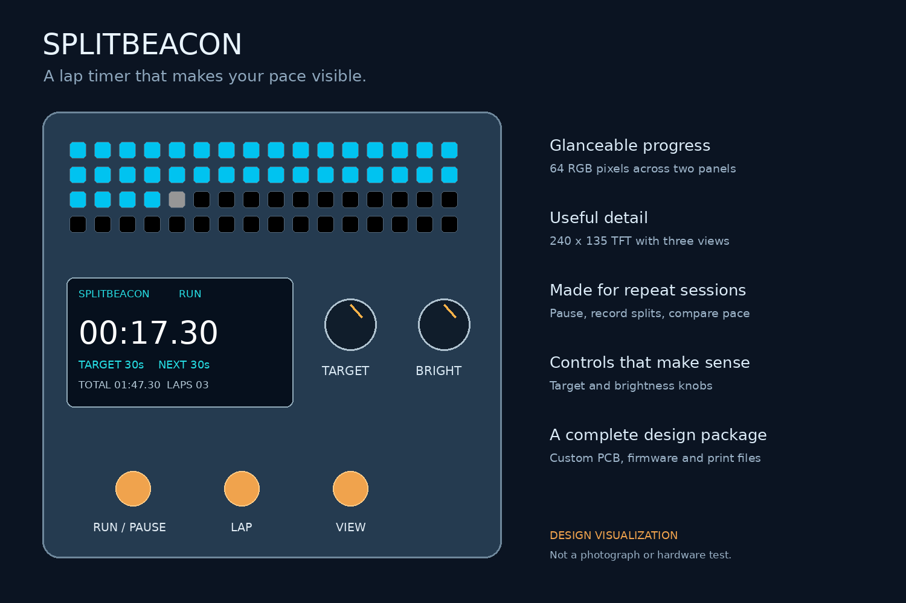
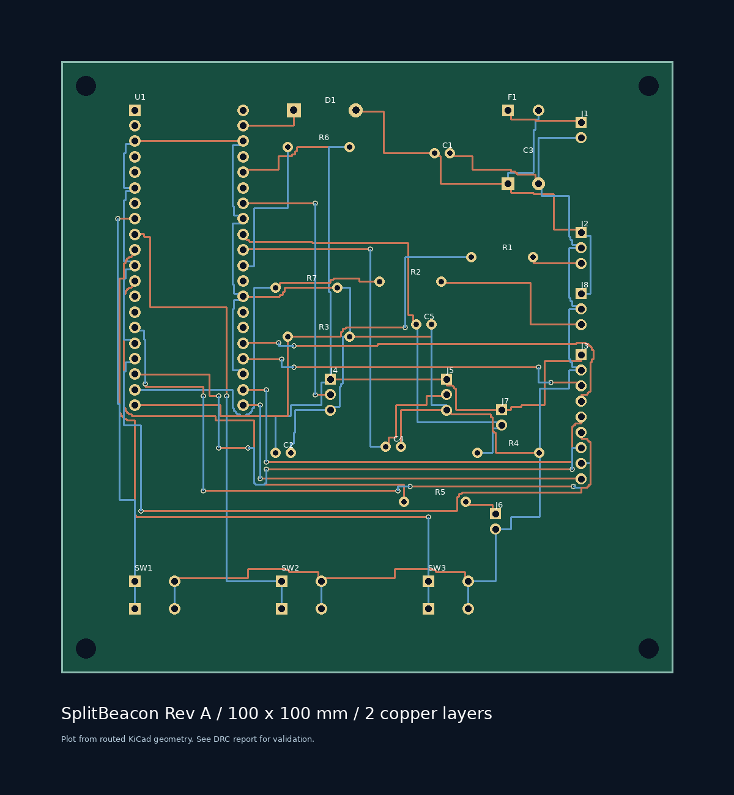
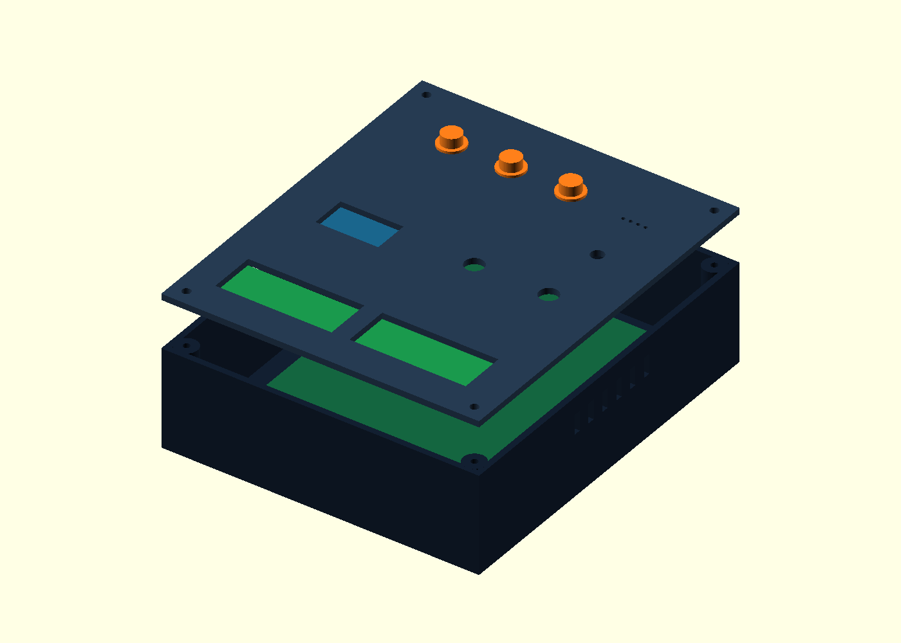

# SplitBeacon

**Half Life Week 4: Displays — Tier 3 design target.** SplitBeacon is Yonathan’s project. Codex assisted with review and submission preparation. The owner confirmed the existing five design sections and their 20-hour total on November 1, 2026. Individual session dates were not supplied; records are retrospective. No physical build or bench testing is represented as completed.

SplitBeacon is a standalone training and repetition timer that turns lap pacing into a visible pattern. Two RGB panels form a 16-by-4 progress display while a small TFT shows precise elapsed time, target time, recent splits, and a session summary. It is useful at a desk, in a practice space, or during dry-land training where unlocking a phone interrupts the session.

## What makes it original

The project combines an adjustable target with a target value latched at the start of each lap. Turning the knob during a lap changes the next target without rewriting the current comparison. The RGB history view encodes whether completed laps were early, close to target, or late. A separate TFT preserves readable numbers while the RGB panels remain glanceable. The design includes a custom controller PCB, analog light sensing, protected external power, a physical interface, original firmware, and a serviceable printable enclosure.

## Controls

- RUN pauses or resumes without counting paused wall time.
- LAP records the current split and starts the next lap. Splits shorter than 250ms are rejected.
- VIEW cycles timer, recent splits, and summary. Hold VIEW for two seconds to clear the session.
- TARGET selects 5–600 seconds. Changes apply to the next lap.
- BRIGHT changes the brightness ceiling; the light sensor reduces output in dark rooms.

The timer gives a short piezo cue when the target is reached. It stores up to 64 split records and saves history when paused. Restarting restores history, not an interrupted live stopwatch.

## Engineering files

- [Editable KiCad project](hardware/controller/controller.kicad_pro), [schematic](hardware/controller/controller.kicad_sch), [routed PCB](hardware/controller/controller.kicad_pcb), and [schematic plot](preview/controller.svg). Local footprints are bundled.
- [Fabrication Gerbers and drill ZIP](hardware/SplitBeacon-gerbers.zip). Board: 100x100mm, two layers, 1.6mm FR4, 1oz copper.
- [MicroPython firmware](firmware/main.py), portable [timer core](firmware/core.py), and original [ST7789 driver](firmware/st7789.py).
- [Parametric enclosure](mechanical/enclosure.scad) and six STL parts, including a tolerance coupon.
- [Full BOM](BOM.md), [purchase spreadsheet](outputs/splitbeacon/SplitBeacon-BOM.xlsx), and [CSV](BOM.csv).
- [Wiring](docs/WIRING.md), [assembly and flashing](docs/ASSEMBLY.md), [verification](docs/VERIFICATION.md), [journal](journal/JOURNAL.md), and [submission text](docs/SUBMISSION.md).

## Validation

Ten portable firmware tests pass. The routed PCB reports zero DRC violations, zero unconnected pads, and zero footprint errors. A separate check compares 88 connected logical pins between the schematic netlist and routed PCB. These checks do not replace bench testing or electrical ERC.

The RGB channels are capped at 16/255 in firmware. The external 5V input powers the displays through a 500mA PTC; a Schottky diode feeds Pico VSYS while keeping its USB supply isolated. Each FeatherWing already has a logic-level shifter, so each is driven through its default control pin on an independent Pico GPIO.

## Budget and scope

Purchased parts and a complete spool total $103.80 before PCB fabrication and final shipping/tax. The BOM exposes package quantities, shipping estimates and the funding gap. Actual supplier-cart screenshots are included. The original package records no purchases. Live submission status must be verified separately.

The scope targets Tier 3 through complete hardware, software and mechanical design. The program determines actual tier and eligibility. Media prepared for this submission uses the actual project files. Concept visualizations, CAD renders and any software simulations are labeled; they do not demonstrate a physical build. Personal work and time requirements must be supported by actual records. Existing AI-assistance credits are retained.
